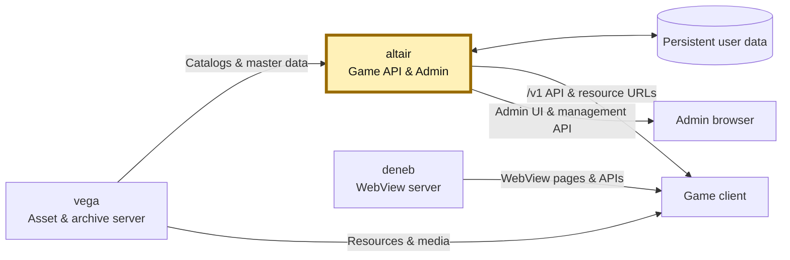

# altair

Self-hosted game API and Admin server. Game routes retain the original client protocol.

## Architecture

## Quick start

Install Bun and Node.js. Run `bun install --frozen-lockfile`, then follow the [installation guide](docs/configuration.md) to prepare the data and start the server.

- `/v1/docs/` serves Swagger UI.
- `/v1/openapi.json` serves the OpenAPI contract.

## Notes

- Compatibility is not 100% complete; some API endpoints, achievement/mission systems, and edge-case behaviors are partial or approximate.

## Disclaimer

This is an unofficial, independent project created strictly for educational, research, and archival purposes, with no intention of infringing any intellectual property rights.

- This project is not affiliated with, endorsed by, or associated with the original game operators, publishers, or rights holders.
- No proprietary game assets, copyrighted media, or user data are included in this repository.
- All game assets, trademarks, and intellectual property belong to their respective copyright holders.

## License

[MIT](LICENSE)
